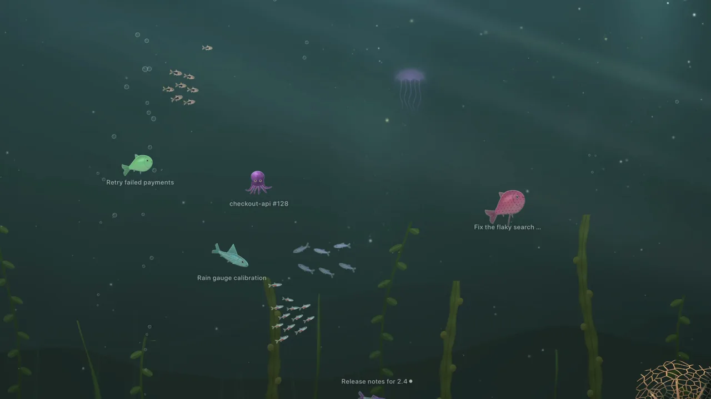
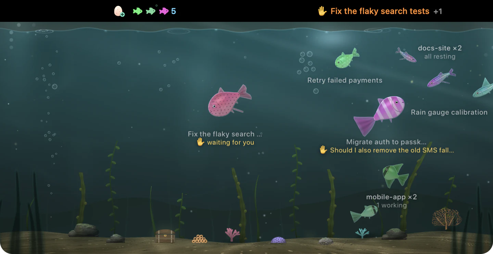
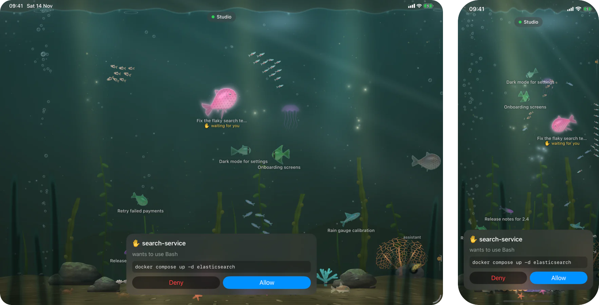
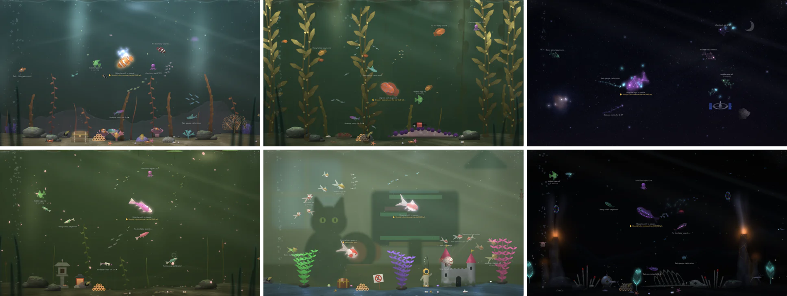

# Fishbots

**Your coding agents, as an aquarium.** Every agent session on your Mac becomes a fish. You see at a glance who's
working, who finished and who's waiting for you — and you hear it, because the aquarium plays each session's state
as music. Answer them from the fish, from the notch, or from your iPhone.

<p align="center">
  
</p>

## What it does

- **Every session is a fish.** It's born when the session starts, swims fast while it works, sinks when idle and
  leaves when the session ends. Subagents are fry, the context window is how fat it is, and each tool has its own
  move (editing nibbles a plant, a shell command puffs bubbles).
- **What needs you comes to the glass.** A session waiting for you queues at the front, and the longer it waits the
  bigger it gets. An error makes it sick: it fades and sinks until it's fixed.
- **You hear it, without looking.** Silence by default; a sound only when something changes. Each session has its own
  short melody, so you know by ear who finished and who's asking.
- **Answer without switching windows.** Hover a fish for its card: the last reply, what it's doing, and
  **Allow / Deny** for a permission request. Type or dictate a reply, or click to jump to its exact terminal pane.
- **In the notch.** Widget mode moves the aquarium into the Mac's notch: who's working on the left, who needs you on
  the right, with the answer buttons right there.
- **On your iPhone and iPad.** The same tank, its cards and the answer buttons, over your network or Tailscale,
  end-to-end encrypted. Sessions keep running on the Mac.
- **An assistant that lives in the tank.** Ask the moray "who's waiting for me?" or "what did the api session do
  today?"; ask it to answer, stop or start a session. It's the agent you already have, running on your account.
- **Sessions that run sessions.** Start a session from the aquarium, or let an agent spawn others and wait for them
  (`fishbots spawn`, `wait`, `reply`): they swim as a school behind their leader.
- **More than agents.** A CI build, a Kubernetes cluster, your PRs, the weather: anything that posts one line of JSON
  becomes a fish or a creature in the tank.
- **Make it yours.** Themes (a reef, the deep sea, a lagoon, a koi pond), packs that add fish, scenery and music
  styles without compiling anything, and a screen saver with your real sessions in it.

<p align="center">
  
</p>
<p align="center">
  
</p>
<p align="center">
  
</p>

> [!NOTE]
> Fishbots is free software, made for learning and for fun, and written with the help of AI coding agents. It isn't
> a commercial product and comes with no warranty of any kind: use it at your own risk.

## How it works

```
agent hooks ──► POST 127.0.0.1:7777 ──► the tank (Metal) + the synthesizer (AVAudioEngine)
                                     └─► 7778, TLS, opt-in ──► iPhone / iPad
```

Each agent's hooks send its events to the app, on your Mac only. The app turns them into states (`busy`, `waiting`,
`error`, `done`…), each state into how the fish swims and how its melody sounds:

| state | the fish | the sound |
|---|---|---|
| working | swims fast, up high | its melody every few bars |
| waiting for you | comes to the glass, bigger | the start of its melody, a question, and taps on the glass |
| error | sick, sinking | its melody, dissonant until fixed |
| done | comes close, then rests | a knock-knock on the glass |
| idle | sleeps near the sand | quiet |

Nothing leaves the Mac unless you turn on other devices, and then only to devices you paired, encrypted with a key
of their own. The app has no AI model in it: the assistant is your own Claude Code or Codex.

## Getting started

Requires macOS 15 and Swift 6 (Xcode or the command line tools).

```sh
git clone https://github.com/vitalbh/fishbots && cd fishbots
scripts/app.sh && open build/Fishbots.app      # builds build/Fishbots.app
scripts/install-hooks.sh claude-code           # or codex, cursor, antigravity, opencode
```

Or connect them from the app: Preferences → General → Agents → **Connect** (the app brings the hooks with it).
That's it: start a session and its fish drops into the tank. Press **D** for a demo with fake sessions.

To answer permission requests from the aquarium, add the permission hook too (it can approve tools on your behalf,
so it's never on by default): `scripts/install-hooks.sh claude-code --permission`.

**iPhone and iPad:** the app isn't on the App Store yet, so it's built from here too. With Xcode, an iPhone plugged in
(Developer Mode on) and your Apple ID in Xcode → Settings → Accounts:

```sh
brew install xcodegen
FISHBOTS_TEAM=<your team id> FISHBOTS_IOS_BUNDLE=<com.you.fishbots> scripts/ios.sh device
scripts/ios.sh sim                                 # or the simulator, no account needed
```

Then turn on Preferences → General → Other devices on the Mac and scan the QR code with the app. A free Apple ID works
(the app then lasts 7 days); notifications on the phone need a paid developer account. More in
[docs/remote.md](docs/remote.md).

**Uninstall:** `scripts/uninstall.sh` takes the hooks out of every agent, then asks before deleting the app's data.

## Supported agents

| agent | fish | answer permissions | reply from the card |
|---|---|---|---|
| Claude Code | depends on the terminal | ✓ | ✓ |
| Codex | ray | ✓ | ✓ |
| Cursor | angelfish | — | `cursor-agent` only |
| Antigravity, opencode | — | — | — (not tried on real sessions yet) |
| Your own | you choose | — | ✓ |

Any agent with hooks can join without changing the app: [docs/agents.md](docs/agents.md).
Jumping to the session works in Rex, Herdr, iTerm, tmux, Ghostty, Terminal, WezTerm, kitty and VS Code-based editors.

## Customize

Almost everything in the tank can be changed without touching the app's code:

- **Themes, fish and scenery:** a pack is a folder with a `pack.json` and Metal drawings. It can bring a whole theme
  (water, light, sand, creatures), new kinds of fish, scenery and music styles, and installs with a double-click.
  `bin/fishbots pack new my-pack` starts one, and `pack dev` reloads it on every save. See [docs/packs.md](docs/packs.md).
- **Things to watch:** a script that prints one line of JSON per thing puts it in the tank as a fish or a creature:
  your PRs, a CI build, a cluster, the weather. See [docs/plugins.md](docs/plugins.md) and [docs/scene.md](docs/scene.md).
- **Another agent:** its hooks post to `/agent/<id>`, and a small manifest names it and picks its fish. See
  [docs/agents.md](docs/agents.md).
- **What calls you:** attention rules per source and state, notifications, webhooks and your own items in the fish
  menu. See [docs/plugins.md](docs/plugins.md).

### Skills for your coding agent

The repository comes with three skills that teach a coding agent (Claude Code, or any agent that reads skills) to do
this for you. `bin/fishbots skill install` copies them to `~/.claude/skills` (or the folder you pass):

| skill | ask your agent to… |
|---|---|
| `fishbots-packs` | "make a Fishbots theme of a coral reef at night", "add a jellyfish to my pack": it writes the pack, checks that its drawings compile and previews them |
| `fishbots-agents` | "make Aider show up in the aquarium": it writes the hook and the manifest and runs a fake session to test it |
| `fishbots-orchestrator` | "split this refactor across three sessions": it starts sessions in panes beside it, waits for them, reads their replies and answers them, while you watch them as fish |

The orchestrator needs **Sessions can command other sessions** on (Preferences → General). See
[docs/orchestration.md](docs/orchestration.md).

## Documentation

- [Using the aquarium](docs/using.md): every gesture and shortcut, the widget, the cards, the assistant, preferences
- [The sound](docs/sound.md): motifs, ambient music, visualizers
- [Agents and terminals](docs/agents.md): each built-in agent, connecting your own
- [Plugins and protocol](docs/plugins.md): the event JSON, the `fishbots` command, script plugins, webhooks, attention rules
- [Orchestration](docs/orchestration.md): sessions that command other sessions
- [Packs](docs/packs.md) and [the scene](docs/scene.md): themes, fish, creatures, presences
- [iPhone and iPad](docs/remote.md): pairing, security, Tailscale, notifications
- [Extension points](docs/extensions.md) and [development](docs/development.md): the architecture, building, testing, releasing

## License

The code is [MIT](LICENSE). The name "Fishbots" and the app icon are not covered by it: a fork or a redistributed
build should use a name and icon of its own.
